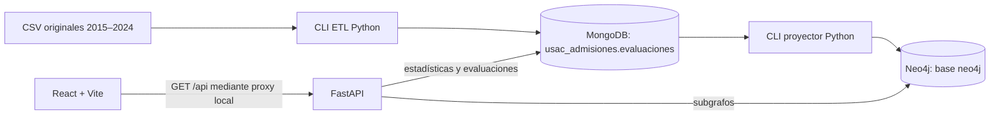

# Manual técnico — Proyecto NoSQL USAC

## 1. Alcance y arquitectura

Sistema académico de análisis de pruebas específicas de admisión de Ingeniería
USAC. El código implementa ETL reproducible, persistencia documental, proyección de
grafos, API de lectura y frontend responsive. El inventario de consultas de este
manual describe código existente, no una lista de funcionalidades futuras.



React 19 utiliza React Router, Recharts y Cytoscape.js. Vite proporciona desarrollo,
proxy y compilación; no es el backend de datos. FastAPI usa Pydantic para contratos
y parámetros. PyMongo y el controlador oficial Neo4j mantienen clientes compartidos
por proceso mediante lifespan; las sesiones Neo4j son cortas y de lectura para la
API. Las rutas síncronas usan el grupo de hilos de FastAPI.

MongoDB y Neo4j se ejecutan en Docker con autenticación y volúmenes persistentes.
React nunca recibe contraseñas de bases. Los comandos CLI de carga están separados
de HTTP: no existen endpoints de carga, edición o eliminación de datos.

| Directorio | Responsabilidad |
| --- | --- |
| backend/app/api | Rutas HTTP de salud y analítica |
| backend/app/models | Modelos Pydantic de entrada/salida |
| backend/app/services | Consultas MongoDB, subgrafos y errores de aplicación |
| backend/app/core | Variables de entorno y manejadores seguros de errores |
| backend/app/database | Clientes y comprobaciones de conexión |
| backend/app/etl | Lectura, normalización, validación y carga MongoDB |
| backend/app/graph | Identidades, inventario, simulación y carga Neo4j |
| backend/tests | Pruebas unitarias e integración de lectura |
| frontend/src | Pantallas, componentes, hooks, cliente HTTP y estilos |
| frontend/e2e | Pruebas Chrome contra la API real |
| consultas/neo4j | Seis archivos Cypher de lectura |
| data/raw | CSV locales, excluidos de Git |
| data/reports | Reportes, checkpoints y capturas locales, excluidos de Git |

## 2. Instalación

Requisitos: Python 3.12 con venv; Node.js >=22.12.0 y <23; npm 10; Docker Engine con
Compose v2. Google Chrome es necesario únicamente para las pruebas Playwright
configuradas con channel chrome. Los comandos siguientes asumen Linux y la raíz
del proyecto como directorio actual.

Obtener la carpeta de entrega completa, incluyendo las etapas 5 y 6. La aplicación previa está publicada, pero el nuevo catálogo de 30 consultas
permanece local en feature/consultas-mongodb hasta autorizar su publicación. Un clon
de main o develop puede no contener ese catálogo. No cambiar de rama con modificaciones sin revisar ni descartarlas.

```bash
python3 --version
node --version
npm --version
docker compose version
python3 -m venv .venv
.venv/bin/python -m pip install -r backend/requirements-dev.txt
npm ci --prefix frontend
.venv/bin/python -m pip check
```

requirements-dev.txt incluye las dependencias de ejecución y de pruebas. Para
solo ejecutar la API puede instalarse backend/requirements.txt. Las versiones de
Python se fijan en esos archivos y las del frontend en package-lock.json. No subir
el entorno virtual, node_modules ni dist.

### Variables de entorno

Crear `.env` solo si no existe, antes de inicializar Docker:

```bash
if [ ! -f .env ]; then cp .env.example .env; fi
chmod 600 .env
```

Editar sus contraseñas con valores propios. No utilizar los ejemplos como secretos
reales ni sobrescribir credenciales de bases existentes. Neo4j requiere al menos
ocho caracteres de contraseña. Cambiar `.env` después de crear los volúmenes no
cambia las contraseñas que ya están almacenadas en las bases.

| Variable | Función / valor por defecto |
| --- | --- |
| MONGO_ROOT_USERNAME | Usuario MongoDB, obligatorio |
| MONGO_ROOT_PASSWORD | Contraseña MongoDB, obligatoria |
| MONGO_HOST / MONGO_PORT | 127.0.0.1 / 27017 |
| MONGO_AUTH_SOURCE | admin; autenticación, no destino de evaluaciones |
| NEO4J_USERNAME / NEO4J_PASSWORD | neo4j / contraseña obligatoria |
| NEO4J_HOST / NEO4J_PORT | 127.0.0.1 / 7687 |
| NEO4J_DATABASE | neo4j; destino admitido por el proyector |
| DB_TIMEOUT_SECONDS | 3; rango 1–10 para conexiones y sockets |
| API_QUERY_TIMEOUT_SECONDS | 10; rango 1–30 para consultas |
| CORS_ORIGINS | Lista JSON de orígenes exactos, por defecto localhost:5173 y 127.0.0.1:5173 con esquema http |

Ejemplo de opciones no secretas:

```dotenv
API_QUERY_TIMEOUT_SECONDS=10
CORS_ORIGINS=["http://localhost:5173","http://127.0.0.1:5173"]
```

CORS no permite comodines, rutas ni credenciales del navegador; no sustituye un
sistema de autenticación. Settings lee el `.env` de la raíz mediante ruta absoluta;
las variables del proceso tienen prioridad. HTTPSettings configura CORS sin crear
conexiones a bases. Si se modifica la configuración, reiniciar el backend propio.

Opciones Vite en frontend/.env.local o en el proceso:
API_PROXY_TARGET=http://127.0.0.1:8000 y FRONTEND_PORT=5173. El ejemplo está en
frontend/.env.example. No se envían al navegador secretos de las bases.

## 3. Docker y persistencia

En una instalación nueva, con `.env` preparado:

```bash
docker compose config --quiet
docker compose up -d --wait --wait-timeout 240
docker compose ps
```

Si los contenedores existentes solo están detenidos, usar `docker compose start`.
No cambiar las credenciales ni recrear volúmenes para solucionar un fallo de conexión.
Las imágenes fijadas son mongo:8.0.16 y neo4j:5.26.12-community. Puertos publicados
solo en loopback: 27017, 7474 y 7687. FastAPI y Vite se ejecutan fuera de Docker.

Volúmenes: mongodb_data, mongodb_config, neo4j_data y neo4j_logs, con prefijo del
proyecto usac-nosql. `docker compose stop` conserva los datos. No ejecutar
`docker compose down -v`, dropDatabase, drop de colecciones ni DETACH DELETE como
parte de instalación, pruebas o cierre. La presente preparación documental no
inició cargas ni cambió contenedores o datos.

## 4. ETL y modelo documental

Obtener los diez CSV de la [fuente oficial de pruebas específicas](https://datosabiertos.ingenieria.usac.edu.gt/en/dataset/pruebas-especificas)
y colocarlos localmente en data/raw con nombres pruebas_especificas_2015.csv hasta
pruebas_especificas_2024.csv. La carpeta y los CSV no se distribuyen por Git.
Docker vacío no incluye automáticamente las evaluaciones: necesita estos originales
y una carga explícita. No ejecutar cargas para usar una instalación ya poblada.

Análisis y simulación sin escrituras a bases:

```bash
PYTHONPATH=backend .venv/bin/python -m app.etl analyze
PYTHONPATH=backend .venv/bin/python -m app.etl load --dry-run --batch-size 1000
```

Los reportes locales se escriben en data/reports: reporte.json, reporte.csv,
rechazos.jsonl y carga.json. Para preservar evidencia de otra ejecución, elegir
un --output-dir distinto. Los CSV se conservan intactos y se verifican con SHA-256.

En una instalación nueva y solo cuando se decida cargar las bases, los comandos
que **sí escriben** son:

```bash
PYTHONPATH=backend .venv/bin/python -m app.etl load --execute --batch-size 1000
PYTHONPATH=backend .venv/bin/python -m app.graph --dry-run
PYTHONPATH=backend .venv/bin/python -m app.graph --execute --batch-size 500
```

Estos comandos se documentan para reproducibilidad; no se ejecutan durante este
cierre. El orden es MongoDB primero y Neo4j después. No volver a cargar para iniciar
el frontend o ejecutar las pruebas de integración.

### Transformaciones

Se lee por nombres, nunca por posición. Los encabezados abreviados de 2022–2024
se resuelven mediante tres alias explícitos. Se validan estructura, fecha ISO,
año del archivo, nacimiento, convocatorias 1–5 y categorías observadas.
SIN REGISTRO y vacíos se convierten a nulos cuando corresponde; SIN DATOS en
procedencia y NINGUNO en carrera también representan ausencia. Los originales se
conservan en el documento.

Las carreras recortadas no se completan. La precisión de municipios desde 2022 no
se garantiza. MATEMATICA ITUGS permanece separada. La edad aproximada atípica genera
advertencia; una fecha o categoría inválida genera rechazo. Advertencia no equivale
a fila rechazada. El detalle completo de reglas está en [etapa 3](etapa-3.md).

Colección fija: usac_admisiones.evaluaciones. Documento:

```text
_id, anio_ingreso, fecha_asignacion, materia, numero_fecha_evaluacion,
aprobado, aspirante, carrera, procedencia_educativa, originales,
calidad.advertencias, fuente, version_transformacion
```

fecha_asignacion es cadena ISO sin hora. El id es SHA-256 de huella del archivo y
número de registro: identifica una ocurrencia de fuente, no una persona. El upsert
usa $setOnInsert y no reemplaza documentos existentes. Se conservan las 834
repeticiones exactas originales. Un archivo modificado produce otra huella y debe
revisarse antes de tratarlo como fuente nueva.

Índices existentes: _id_ único automático; anio_materia sobre año/materia;
aspirante_cohorte sobre aspirante.cohorte_id; fuente_sha256 sobre la huella de origen.
No hay una colección materializada resumen_carrera implementada.

## 5. Modelo Neo4j, idempotencia y recuperación

Ocho etiquetas, todas con id único: Evaluacion, AspiranteCohorte, Cohorte, Materia,
CarreraObservada, LocalidadEducativa, Departamento y TipoInstitucion. Los nodos
pertenecen además a USACAdmision. Evaluacion reutiliza _id de MongoDB;
AspiranteCohorte utiliza año:correlativo; las otras identidades usan el año o hashes
deterministas de sus componentes. Carrera incluye valor y estado de normalización;
localidad incluye departamento, etiqueta y precisión.

Relaciones: TIENE_REGISTRO, EN_COHORTE, DE_MATERIA, ASPIRA_A,
PROCEDENCIA_EDUCATIVA, EN_DEPARTAMENTO y TIPO_INSTITUCION.
No se inventan personas globales, establecimientos concretos ni residencias.
Además de ocho restricciones únicas, existe el índice compuesto
Evaluacion(anio_ingreso, aprobado). Se conservaron los dos índices LOOKUP originales.

El proyector prevalida la fuente y rechaza colisiones de propiedades. Cada lote de
500 evaluaciones se confirma en una transacción mediante UNWIND y MERGE; las
propiedades se asignan solo al crear el nodo. Los reintentos automáticos están
desactivados. No hay transacción global de toda la carga; un error deja los lotes
anteriores y detiene el proceso, sin borrarlos.

El checkpoint local se guarda atómicamente después del commit: huella, versión,
host, puerto, base y último _id confirmado. Para reanudar una ejecución realmente
incompleta, con la misma fuente y el directorio que contiene su checkpoint:

```bash
PYTHONPATH=backend .venv/bin/python -m app.graph --execute --resume --batch-size 500 --output-dir data/reports/neo4j
```

No usar ese directorio si el checkpoint real está en otro. Comprobar primero que
no haya procesos activos; no reutilizar checkpoints después de recrear una base.
En la instalación validada ambas pasadas completas terminaron y no quedan registros
pendientes, por lo que no es necesario reanudar. Más detalle: [etapa 4](etapa-4.md).

## 6. Ejecución de API y frontend

Terminal del backend:

```bash
.venv/bin/python -m uvicorn app.main:app --app-dir backend --reload --host 127.0.0.1 --port 8000
```

Terminal del frontend:

```bash
npm run dev --prefix frontend
```

Aplicación: http://127.0.0.1:5173; Swagger: http://127.0.0.1:8000/docs;
OpenAPI: http://127.0.0.1:8000/openapi.json; Neo4j Browser: http://127.0.0.1:7474.
Ante puertos ocupados, usar backend 8001 y
`API_PROXY_TARGET=http://127.0.0.1:8001 FRONTEND_PORT=5174 npm run dev --prefix frontend`.
No detener servicios ajenos. Los comandos se ejecutan desde la raíz.

La API contiene 11 rutas GET. Las dos de salud mantienen su contrato original;
las nuevas responden con status, data y meta, o status:error y error seguro.
422 indica parámetros inválidos; 404, recurso concreto inexistente; 503, base
inaccesible; 504, timeout; 500, error interno. La consulta de evaluaciones usa
cursor por id, máximo 100 registros. Grafos: hasta 100 evaluaciones, 500 nodos y
800 relaciones, con meta.truncado si hay más. Los parámetros y ejemplos completos
se encuentran en [etapa 5](etapa-5.md).

## 7. Consultas realmente implementadas

### MongoDB

Archivo: [mongo_analytics.py](../backend/app/services/mongo_analytics.py).
La API contiene siete operaciones de consulta, reutilizadas por el nuevo catálogo
de 30 consultas. No se cuentan combinaciones de parámetros como si fueran consultas
distintas ni catálogos reutilizados dos veces.

| Función | Consulta existente | Endpoint |
| --- | --- | --- |
| statistics | $match y $group: totales, aprobados y advertencias; tasa en Python | /api/estadisticas |
| evaluations | find con proyección, orden por _id y límite/cursor | /api/evaluaciones |
| approval | Agrupación por año y materia | /api/estadisticas/aprobacion |
| careers | Agrupación por valor y estado de carrera | /api/resultados/carreras |
| provenance | Agrupación por departamento y tipo educativo | /api/procedencia |
| both_subjects | Materias aprobadas por aspirante de cohorte con $addToSet y $all | /api/resultados/ambas-materias |
| catalogs | $facet para años/materias/tipos y reutilización de careers | /api/catalogos |

Los filtros validados se construyen en el servidor. No hay SQL ni consultas MongoDB
arbitrarias enviadas por el cliente. También existen ping, conteos y comprobaciones
en ETL/pruebas; no se cuentan como consultas analíticas adicionales.
El [catálogo MongoDB](consultas-mongodb.md) incorpora ahora **30 consultas diferentes**:
reutiliza las siete operaciones de la tabla y añade 23 análisis. Incluye un find,
un countDocuments y análisis de agregación por año, materia, sexo, carrera,
procedencia y calidad. No se crearon nuevos endpoints para duplicar la API.

```bash
PYTHONPATH=backend .venv/bin/python -m app.queries.mongodb --list
PYTHONPATH=backend .venv/bin/python -m app.queries.mongodb --all
```

El código, las explicaciones y los resultados reales de las 30 consultas están en
ese documento. El requisito indicado de al menos 20 consultas queda cubierto.
**resumen_carrera sigue sin implementarse**: es una colección materializada
mencionada en el plan inicial, no un efecto del catálogo de lectura. Los límites
de tiempo de consola no cambian los de la API.

### Cypher

Seis consultas distintas existentes en [consultas/neo4j](../consultas/neo4j).
Todas son de lectura y están explicadas también en [etapa 4](etapa-4.md).

| Archivo | Análisis / recorrido | Parámetros |
| --- | --- | --- |
| 01_aprobacion.cypher | Evaluacion → Cohorte y Materia; tasa por grupo | desde, hasta |
| 02_carreras.cypher | Evaluacion → CarreraObservada y Materia | anio, materia |
| 03_visualizacion.cypher | AspiranteCohorte → Evaluacion → Materia y CarreraObservada; hasta 100 caminos | anio, materia, carrera_id, aprobado |
| 04_aspirante.cypher | Registros y materias de un aspirante dentro de su cohorte | cohorte_id |
| 05_ambas_materias.cypher | Aspirantes con aprobación en Matemática y Computación | anio |
| 06_procedencia.cypher | Evaluacion → LocalidadEducativa → Departamento, y TipoInstitucion | anio |

Para ejecutarlas en Neo4j Browser, seleccionar la base neo4j, establecer parámetros
y pegar el contenido del archivo. Ejemplo con la consulta 01:

```cypher
:param desde => 2024;
:param hasta => 2024;
```

Después ejecutar 01_aprobacion.cypher. Para las demás, obtener carrera_id o
cohorte_id desde /api/catalogos y /api/evaluaciones; no inventar identidades.
EXPLAIN delante de la consulta permite revisar el plan sin ejecutarla.
La consulta 02 requiere materia: para todas las materias el endpoint MongoDB sí
admite omitirla, pero el archivo Cypher no tiene ese mismo filtro opcional.

Los endpoints de estadísticas usan MongoDB, no estos archivos Cypher. Los de grafos
usan [graph_queries.py](../backend/app/services/graph_queries.py): selección limitada
de evaluaciones o cohorte y expansión parametrizada de los recorridos del modelo.
No existe una ruta HTTP para ejecutar Cypher arbitrario. La consulta Cypher 06 no
incluye procedencias nulas, mientras que su equivalente MongoDB sí las conserva.

## 8. Pruebas y compilación

Ejecutar de forma **secuencial**, no simultáneamente con otras cargas o pruebas de
credenciales. La auditoría concurrente produjo respuestas 503; la repetición aislada
de Chrome pasó sin cambios de código. Esto no demuestra una causa única de esos
fallos, por lo que no se presentan como un defecto corregido de la aplicación.

```bash
USAC_RUN_DB_TESTS=1 PYTHONPATH=backend .venv/bin/python -m unittest discover -s backend/tests -v
npm test --prefix frontend
npm run build --prefix frontend
npm run test:e2e --prefix frontend
.venv/bin/python -m pip check
git diff --check
```

La suite backend tiene 46 pruebas, incluyendo el catálogo MongoDB; incluye integración real de lectura, salud,
ETL y grafo. Las pruebas que simulan cargas utilizan dobles en memoria, no las
bases reales. test_api_readonly requiere USAC_RUN_DB_TESTS=1; las pruebas de salud
existentes requieren bases disponibles incluso sin esa bandera. No invocar --execute
para ejecutar pruebas.

Frontend: 13 pruebas Vitest/Testing Library y 8 recorridos Playwright con endpoints
reales. Playwright necesita Chrome y puertos libres 8010/5180, inicia sus servidores
propios y los cierra al terminar. No sustituye estadísticas con datos simulados;
solo provoca un fallo de red en el caso específico de recuperación.

Vite genera frontend/dist, ignorado por Git. No existe un paso de compilación
binaria FastAPI; importar la app, generar OpenAPI y las pruebas verifican su carga.
Las capturas/trazas quedan bajo data/reports/etapa-6. Los conteos antes/después de
integración se guardan en data/reports/etapa-5/verificacion-api.json.

## 9. Resultados comprobados y límites

Los reportes de cargas previas y las pruebas de integración comprobaron 208453
evaluaciones en MongoDB y Neo4j, 265293 nodos y 1222881 relaciones en el grafo.
Ambas cargas completas se repitieron sin duplicados. El agregado general devuelve
29877 aprobados, 178576 no aprobados y 14.33%; son registros, no personas únicas.
Estos números describen la instalación validada, no se fijan como respuesta de la
API. Otra instalación debe cargarse y verificarse con sus fuentes.

Se preservan 834 repeticiones originales y 56147 filas con advertencias. No se
realiza seguimiento global de personas, reconstrucción de carreras/municipios,
identificación de establecimientos ni inferencia de admisión definitiva.
El proyecto está configurado para desarrollo académico local, no incluye un
sistema de usuarios ni un despliegue público de producción.

## 10. Entrega y secretos

Versionar código, pruebas, manuales, plantillas .env.example y lockfiles.
Excluir .env, frontend/.env.local, contraseñas, data/raw, data/reports, .venv,
node_modules, dist, cachés y archivos temporales. No incluir credenciales reales
en capturas o manuales. Revisar git status y git diff --check antes de preparar
el commit. Las etapas 5 y 6 ya están publicadas. El catálogo de 30 consultas de
feature/consultas-mongodb permanece pendiente de autorización para publicación;
no se ha realizado commit, merge ni push en esta nueva etapa.

### Verificación de este cierre documental

Se ejecutaron secuencialmente compilación de módulos Python, 38 pruebas backend,
13 frontend, compilación Vite, 8 pruebas Chrome, pip check, validación Compose y
git diff --check. Todas finalizaron con código 0. Los conteos de control permanecieron
en 208453 documentos MongoDB, 265293 nodos y 1222881 relaciones Neo4j. La revisión de
80 archivos versionados o candidatos no encontró secretos locales, credenciales
incrustadas, originales ni reportes generados incluidos en Git. Los enlaces locales
de README y ambos manuales se comprobaron. El índice Git permanece vacío.
